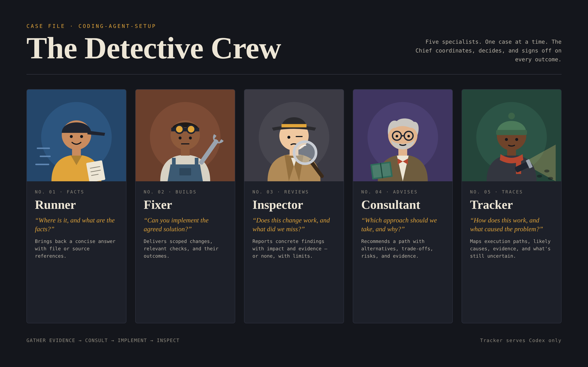

# Detective Crew Agents

Detective Crew agents for Codex, Claude Code, OpenCode, and Grok Build.
Subagent definitions and delegation rules, installed with one command, that
apply across every project on your machine.

```sh
npx @rujealfon/detective-crew-agents
```

## Meet the Detective Crew



Your main agent is the Chief: it coordinates the case, makes the decisions,
integrates changes, and verifies the outcome. The crew does the legwork.

| | Crew member | Question it answers | Expected result |
| --- | --- | --- | --- |
|  | **Runner** | Where is it, and what are the facts? | A concise answer with file or source references |
|  | **Fixer** | Can you implement the agreed solution? | Scoped changes, relevant checks, and their outcomes |
|  | **Inspector** | Does this change work correctly, and what did we miss? | Concrete findings with impact and evidence, or no findings with verification limits |
|  | **Consultant** | Which approach should we take, and why? | A recommendation, alternatives, trade-offs, risks, and supporting evidence |
|  | **Tracker** (Codex only) | How does this work, and what caused the problem? | Execution paths, likely causes, evidence, and remaining uncertainty |

### Models per tool

| Tool | `runner` | `fixer` | `inspector` | `consultant` | `tracker` | `default` | `explore` | `general` |
| --- | --- | --- | --- | --- | --- | --- | --- | --- |
| Codex | `gpt-6-luna` | `gpt-6.1-terra` | `gpt-6.1-sol` | `gpt-6-astra` | `gpt-6-luna` | `gpt-6.1-sol` | N/A | N/A |
| Claude Code | `claude-haiku-5-5`, medium | `claude-sonnet-5-5`, medium | `claude-sonnet-5-5`, high | `claude-opus-5-5`, high | N/A | N/A | N/A | N/A |
| OpenCode | `opencode-go/muse-spark-1.3-contributor`, high | `opencode-go/deepseek-v4.1-flash`, max | `opencode-go/deepseek-v4.1-flash`, max | `opencode-go/glm-5.3-flash`, max | N/A | N/A | `opencode-go/muse-spark-1.3-contributor`, high | `opencode-go/deepseek-v4.1-flash`, max |
| Grok Build | `grok-4.7`, low | `grok-4.7`, medium | `grok-4.7`, high | `grok-4.7`, xhigh | N/A | N/A | N/A | N/A |

N/A means the tool doesn't get that role. Codex leaves effort to the Chief at
spawn time, so its row lists models only. `default` (Codex) and `general`
(OpenCode) handle mixed work; `explore` (OpenCode) traces code.

## How a case runs

Use only the stages a task needs. Small tasks stay with the Chief.

1. **Gather evidence**: Runner looks things up; Tracker (or a built-in explorer) traces deeper.
2. **Consult**: Consultant weighs in on an unresolved design decision, or after two failed bug-fix attempts.
3. **Implement**: Fixer makes the agreed change in the files it owns.
4. **Inspect**: Inspector reviews the combined diff against the requirements.

A failing test with a clear cause can go straight to Fixer, then Inspector.
Read-only roles can't run shell commands or tests, so hand them the diff and
test output.

## The crew in each tool

Each tool gets its own delegation policy. Full per-tool rules, permissions, and
effort levels are in [docs/orchestration.md](docs/orchestration.md).

### Claude orchestration

| Agent | Assignment | Configuration |
| --- | --- | --- |
| `runner` | Bounded factual lookup or file discovery with references | Haiku 5.5, medium; max 15 turns, reports from 12 tool calls; Read, Glob, Grep, WebFetch, WebSearch |
| `fixer` | Implement an agreed change within owned files and verify it | Sonnet 5.5, medium; no turn limit; inherited tools, including shell, editing, skills, and MCP; Agent disabled |
| `inspector` | Review a supplied diff for concrete defects and explain their impact | Sonnet 5.5, high; max 60 turns, reports from 50 tool calls; Read, Glob, Grep, WebFetch, WebSearch |
| `consultant` | Advise on architecture, design trade-offs, and stubborn bugs; use sparingly | Opus 5.5, high; max 30 turns, reports from 24 tool calls; Read, Glob, Grep, WebFetch, WebSearch |
| `Explore` built-in | Trace behavior and dependencies across the codebase | Built-in read-only tools |
| `Plan` built-in | Gather research during plan mode | Built-in read-only tools |
| `general-purpose` built-in | Mixed investigation and action without a matching specialist | Built-in available tools |

High-risk changes always get an Inspector review. The riskiest also get one
Opus review; [claude/docs/opus-review.md](claude/docs/opus-review.md) lists
which changes qualify and the steps.

### Codex orchestration

| Agent | Assignment | Configuration |
| --- | --- | --- |
| `runner` | Bounded factual lookup or file discovery with references | Luna; read-only sandbox |
| `fixer` | Implement an agreed change within owned files and verify it | Terra; inherited permissions |
| `inspector` | Review a specified diff for concrete defects and explain their impact | Sol; read-only sandbox |
| `consultant` | Advise on architecture, difficult trade-offs, and stubborn bugs | Astra; read-only sandbox |
| `tracker` | Trace behavior, dependencies, and likely causes across files | Luna; read-only sandbox |
| `default` | Bounded mixed investigation and implementation without a matching specialist | Sol; inherited permissions |

Read-only roles run with `sandbox_mode = "read-only"`. Effort isn't fixed: the
Chief picks it for each task when spawning.

### OpenCode orchestration

| Agent | Assignment | Configuration |
| --- | --- | --- |
| `runner` | Bounded factual lookup or file discovery | Muse Spark 1.3 Contributor, high; inherited permissions |
| `fixer` | Implement an agreed change and verify it | DeepSeek V4.1 Flash, max; inherited permissions |
| `inspector` | Review a supplied diff for concrete defects | DeepSeek V4.1 Flash, max; inspection tools |
| `consultant` | Advise on unresolved design choices and stubborn bugs | GLM-5.3-Flash, max; inspection tools |
| `explore` | Trace behavior and dependencies across files | Muse Spark 1.3 Contributor, high; built-in exploration permissions |
| `general` | Mixed investigation and implementation | DeepSeek V4.1 Flash, max; built-in general permissions |

Inspector and Consultant can only read, search, and fetch. `explore` and
`general` are OpenCode's built-in agents with this setup's models.

### Grok orchestration

| Agent | Assignment | Configuration |
| --- | --- | --- |
| `runner` | Bounded factual lookup or file discovery | Grok 4.7, low; inherited capabilities |
| `fixer` | Implement an agreed change and verify it | Grok 4.7, medium; inherited capabilities |
| `inspector` | Review a supplied diff for concrete defects | Grok 4.7, high; read-only capability mode |
| `consultant` | Advise on unresolved design choices and stubborn bugs | Grok 4.7, xhigh; read-only capability mode |

All roles use Grok 4.7 at different efforts. Inspector and Consultant run in
read-only capability mode.

## Install, update, uninstall

Needs Node.js 18+ and Python 3. It installs configuration only, not the tools
themselves or credentials.

```sh
npx @rujealfon/detective-crew-agents                  # choose tools from a menu
npx @rujealfon/detective-crew-agents --tool claude    # skip the menu (repeatable)
npx @rujealfon/detective-crew-agents --dry-run        # preview changes
npx @rujealfon/detective-crew-agents --update         # upgrade an earlier install
npx @rujealfon/detective-crew-agents --uninstall      # remove recognized files
```

Files you've customized are never overwritten: the installer stops and reports
them. `--update` backs up each file it replaces. Start a fresh tool session
afterward.

| Tool | Delegation policy | Agents |
| --- | --- | --- |
| Codex | `~/.codex/AGENTS.md` | `~/.codex/agents/` |
| Claude Code | `~/.claude/rules/delegation.md` | `~/.claude/agents/` |
| OpenCode v2 | `~/.config/opencode/AGENTS.md` | `~/.config/opencode/agents/`, `opencode.jsonc` |
| Grok Build | `~/.grok/rules/delegation.md` | `~/.grok/agents/` |

All options, upgrade behavior, and project-level instructions:
[docs/install.md](docs/install.md).

## More docs

- [Orchestration details](docs/orchestration.md): per-tool rules, permissions, effort, and the fixer benchmark
- [Install reference](docs/install.md): menus, flags, upgrades, uninstall, instruction paths
- [Repository layout and testing](docs/repository.md): file map, CI, and tests
- [Local Codex usage reports](docs/session-usage.md): token usage per agent from Codex session logs

Run the tests:

```sh
python3 -B -m unittest discover -s tests -v
```

## License

[MIT](LICENSE), copyright 2026 Ruje Alfon.

Codex also installs [context and token-use guidance](codex/docs/token-usage.md)
to `~/.codex/docs/token-usage.md`, linked from its global policy.
